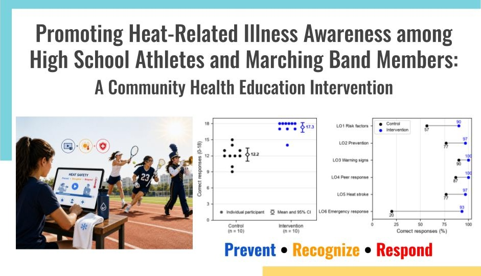

<!--
## Promoting Heat-Related Illness Awareness among High School Athletes and Marching Band Members: A Community Health Education Intervention
-->

  

## Short Summary 

Heat-related illnesses (HRIs), such as heat cramps, heat exhaustion, and heat stroke, pose a preventable but potentially life-threatening risk to high school students who engage in exertional activities. However, targeted HRI education remains limited. This work develops and evaluates a 10-minute, self-paced online educational module structured around six learning objectives derived from published guidance on HRI prevention, recognition, and emergency response. A pilot study tested the module in a randomized controlled trial with high school athletes and marching band members assigned to intervention and control groups. Preliminary results show a positive short-term effect on HRI knowledge and support the feasibility of low-cost online delivery.

## Extended Summary

Heat-related illnesses (HRIs) range from heat cramps and heat exhaustion to potentially fatal heat stroke. They occur when heat exposure, physical exertion, or both exceed the body’s ability to regulate temperature. Heat stroke can involve central nervous system dysfunction.

HRI risk is amplified during sports and other vigorous activities in hot and humid conditions. HRIs are among the top three causes of athlete deaths. From 2000 to 2024, at least 77 U.S. athletes died from HRIs, including 65 teenagers (84%)13. Over 9,000 high school athletes receive HRI treatment annually. Marching band members face HRI risk in full uniforms while carrying instruments.

For both athletes and marching band members, environmental risk factors include high temperature and humidity, direct sun exposure, limited airflow, and radiant heat from sun-heated surfaces (e.g., asphalt and concrete). Other risk factors include insufficient heat acclimatization, dehydration, previous heat illness, poor sleep, intense or prolonged exertion, and heat-trapping uniforms and equipment. Acclimatization is often underestimated; HRIs can occur even before summer in cooler regions. 

Since these factors interact, prevention requires more than hydration alone. It also involves gradual acclimatization, environmental monitoring, adjusted activity intensity and work-to-rest ratios, symptom recognition, and emergency action plans that specify rapid cooling before transport for suspected heat stroke4,5. The American Academy of Pediatrics recommends regularly educating students about acclimatization, hydration, honest symptom reporting, recovery, and rest.

This work develops a community health intervention focused on HRI prevention, recognition, and emergency response among high school athletes and marching band members. It is delivered through a self-paced online educational module and evaluated through a randomized controlled trial. 

<!--
## Publications
- H. Suzuki, A Heat-Related Illness Education Intervention for High School Athletes and Marching Band Members, In *Proc. of Harvard Global Health and Leadership Conference*, September, 2026. [preprint](./doc/harvard-vision26.pdf)
-->

<!--
### Presentations 
-->

## Relevant Projects

This project is closely related to the [AlertAthlete](https://github.com/HSSBoston/alertathlete/) project, which develops a machine learning-based algorithm for HRI risk esitmation and implements a supporting wearable device. You may find the [SipLog](https://github.com/HSSBoston/sip-log) project relevant/interesting too. 

## Personal Context

Last April, I experienced symptoms of heat-related illness (HRI) in a tennis match. One of my teammates developed more severe symptoms and was transported by ambulance for evaluation. It was not an isolated incident—I have seen HRIs affect teammates over multiple seasons. What surprised me most was that these episodes happened in spring in Massachusetts, not midsummer. That left me frustrated, but also motivated me to learn more and eventually start this project.

As I researched the issue, I learned that what I had seen on the tennis court was not unusual. Heat risk is not limited to midsummer or hot climates; students can be especially vulnerable early in the season, before their bodies have had time to adjust to the heat. Yet this risk is not always communicated to students; my school and neighboring teams, for example, lack preseason heat-safety education. I also found that many existing student-focused interventions emphasize hydration without fully addressing prevention, early recognition, and emergency response. My own experience, what I saw happen to my teammates, and the gaps I found in existing education shaped this project: an effort to give students the heat safety knowledge I wish my teammates and I had received before stepping onto the court.

